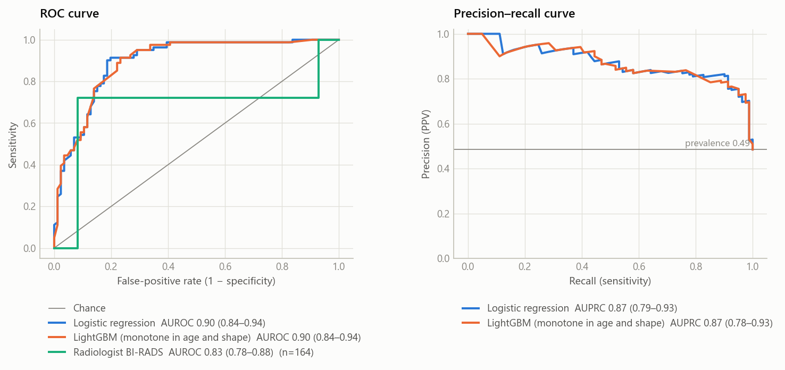
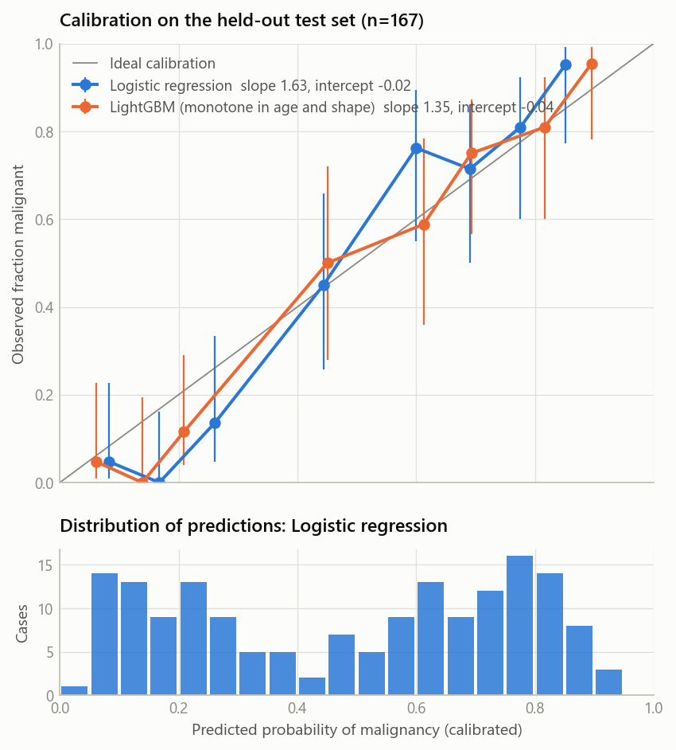
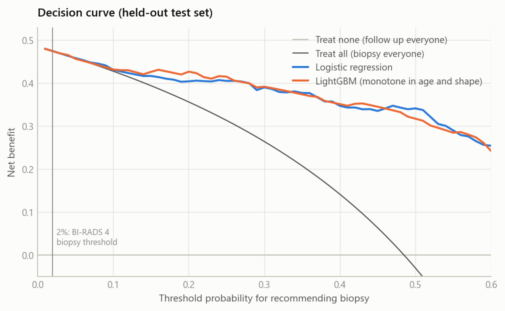
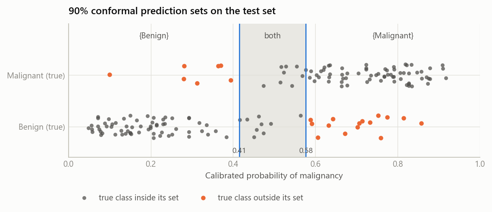

# Evaluation report

<!-- generated by scripts/update_readme_metrics.py from models/model_metadata.json; do not edit by hand -->

## Protocol

Stratified split of the 831 cleaned rows (seed 2026): fit 60%, conformal 20%, test 20%. Model selection by 5-fold CV log-loss on the fit split with a one-standard-error rule favouring simpler models. Calibration method and decision thresholds are chosen on out-of-fold predictions of the fit split; final models are trained on the whole fit split. Conformal cut-offs use only the conformal split. The test split is used once, for the reported metrics (95% percentile bootstrap CIs, 2,000 resamples, paired across models).

- Split sizes: fit 498, conformal 166, test 167 (seed 2026; row ids in `models/splits.json`).
- Risk categories: Low < 0.35 ≤ Moderate < 0.65 ≤ Elevated (calibrated probability).

## Model selection (5-fold CV on the fit split)

Rule: Lowest mean 5-fold CV log-loss on the fit split; a simpler family within one standard error of the best is preferred (logistic regression < monotone LightGBM < LightGBM). Best by CV: `lightgbm_monotone`; one-SE bound 0.5222; **selected: `logistic_regression`**, challenger: `lightgbm_monotone`.

| Family | Parameters | CV log-loss (mean ± SE) | CV AUROC |
|---|---|---|---|
| lightgbm_monotone | num_leaves=8, min_child_samples=40 | 0.4891 ± 0.0331 | 0.8399 |
| lightgbm_monotone | num_leaves=16, min_child_samples=40 | 0.4891 ± 0.0331 | 0.8399 |
| lightgbm_monotone | num_leaves=4, min_child_samples=40 | 0.4906 ± 0.0334 | 0.8392 |
| lightgbm_monotone | num_leaves=16, min_child_samples=20 | 0.4922 ± 0.0327 | 0.8344 |
| logistic_regression | C=0.1 | 0.4925 ± 0.0264 | 0.8435 |
| lightgbm_monotone | num_leaves=4, min_child_samples=20 | 0.4941 ± 0.0322 | 0.8381 |
| lightgbm_monotone | num_leaves=16, min_child_samples=10 | 0.4945 ± 0.0329 | 0.8343 |
| lightgbm | num_leaves=4, min_child_samples=40 | 0.4946 ± 0.0308 | 0.8397 |
| lightgbm_monotone | num_leaves=8, min_child_samples=20 | 0.4954 ± 0.0324 | 0.8365 |
| logistic_regression | C=1.0 | 0.4967 ± 0.0354 | 0.8404 |
| lightgbm_monotone | num_leaves=8, min_child_samples=10 | 0.4982 ± 0.0318 | 0.8321 |
| lightgbm_monotone | num_leaves=4, min_child_samples=10 | 0.4987 ± 0.0307 | 0.8375 |
| lightgbm | num_leaves=8, min_child_samples=40 | 0.5000 ± 0.0286 | 0.8343 |
| lightgbm | num_leaves=16, min_child_samples=40 | 0.5002 ± 0.0285 | 0.8343 |
| lightgbm | num_leaves=4, min_child_samples=20 | 0.5019 ± 0.0287 | 0.8316 |
| logistic_regression | C=10.0 | 0.5046 ± 0.0385 | 0.8379 |
| lightgbm | num_leaves=4, min_child_samples=10 | 0.5061 ± 0.0281 | 0.8319 |
| lightgbm | num_leaves=8, min_child_samples=20 | 0.5114 ± 0.0249 | 0.8222 |
| lightgbm | num_leaves=8, min_child_samples=10 | 0.5127 ± 0.0267 | 0.8211 |
| lightgbm | num_leaves=16, min_child_samples=20 | 0.5154 ± 0.0240 | 0.8180 |
| lightgbm | num_leaves=16, min_child_samples=10 | 0.5228 ± 0.0230 | 0.8136 |
| logistic_regression | C=0.01 | 0.5534 ± 0.0125 | 0.8403 |

## Calibration and thresholds (out-of-fold predictions, fit split)

| Model | CV Brier by calibration method | Chosen | Youden threshold | High-sensitivity threshold |
|---|---|---|---|---|
| Logistic regression (served) | none 0.16036, sigmoid 0.16095, isotonic 0.16694 | `none` | 0.514 | 0.203 |
| LightGBM (monotone in age and shape) (challenger) | none 0.16216, sigmoid 0.16413, isotonic 0.16519 | `none` | 0.474 | 0.154 |
| LightGBM (ablation) | none 0.16202, sigmoid 0.16419, isotonic 0.16839 | `none` | 0.452 | 0.150 |

## Test-set metrics (n = 167, 81 malignant; 95% bootstrap CIs)

| Metric | Logistic regression (served) | LightGBM (monotone in age and shape) (challenger) | LightGBM (ablation) |
|---|---|---|---|
| auroc | 0.90 (0.84–0.94) | 0.90 (0.84–0.94) | 0.89 (0.84–0.93) |
| auprc | 0.87 (0.79–0.93) | 0.87 (0.78–0.93) | 0.86 (0.77–0.92) |
| brier | 0.132 (0.110–0.160) | 0.129 (0.104–0.159) | 0.129 (0.104–0.160) |
| ece | 0.116 (0.096–0.181) | 0.092 (0.078–0.160) | 0.098 (0.083–0.164) |
| calibration_intercept | -0.02 (-0.35 to 0.27) | -0.04 (-0.40 to 0.28) | -0.04 (-0.39 to 0.28) |
| calibration_slope | 1.63 (1.25–2.21) | 1.35 (1.02–1.86) | 1.37 (1.05–1.82) |
| sensitivity | 0.90 (0.83–0.96) | 0.91 (0.85–0.96) | 0.91 (0.85–0.96) |
| specificity | 0.81 (0.72–0.89) | 0.77 (0.67–0.85) | 0.77 (0.67–0.85) |
| ppv | 0.82 (0.74–0.89) | 0.79 (0.70–0.86) | 0.79 (0.70–0.86) |
| npv | 0.90 (0.82–0.96) | 0.90 (0.83–0.96) | 0.90 (0.83–0.96) |

Served model at its threshold: {'tp': 73, 'fp': 16, 'tn': 70, 'fn': 8}.

Paired differences (same bootstrap resamples):
- AUROC, served − challenger: +0.001 (-0.011 to +0.015)
- Brier, served − challenger: +0.003 (-0.004 to +0.010)
- Monotone ablation, AUROC (monotone − unconstrained LightGBM): +0.004 (-0.004 to +0.014)
- Monotone ablation, Brier: -0.001 (-0.004 to +0.003)

## Conformal prediction sets (served model, target 90% per class)

Fitted on the conformal split (85 benign, 81 malignant). Benign is in the set if p ≤ 0.577; Malignant if p ≥ 0.415.

| Test-set quantity | Value (95% CI) |
|---|---|
| coverage | 0.87 (0.81–0.92) |
| coverage benign | 0.83 (0.74–0.90) |
| coverage malignant | 0.91 (0.85–0.97) |
| share single label | 0.89 (0.84–0.93) |
| share both labels | 0.11 (0.07–0.16) |
| share empty | 0.00 (0.00–0.00) |

The guarantee holds on average over random calibration and test draws; a single split of this size can land below the target.

## High-sensitivity operating point

Threshold 0.203 (highest out-of-fold threshold with sensitivity ≥ 95%): sensitivity 0.99 (0.96–1.00), specificity 0.42 (0.31–0.52), NPV 0.97 (0.90–1.00).
At this point, the specificity is the share of benign masses that fell below the threshold.

## Reference: radiologists' BI-RADS assessment

On 164 test rows (3 excluded: BI-RADS missing or outside the documented 1–5 range (0, 6, 55)): BI-RADS AUROC 0.83 (0.78–0.88); served model on the same rows 0.89 (0.84–0.94); difference +0.064 (-0.001 to +0.121). BI-RADS is a coarse management category (mostly 4 or 5 here), not a probability, so this is context rather than a head-to-head claim.

## Subgroups (age, split at 50; served model at its global threshold)

| Group | n | Malignant | AUROC | Sensitivity | Specificity | Calibration intercept |
|---|---|---|---|---|---|---|
| age < 50 | 56 | 14 | 0.90 (0.77–0.98) | 0.71 (0.46–0.93) | 0.90 (0.81–0.98) | -0.18 (-0.86 to 0.35) |
| age ≥ 50 | 111 | 67 | 0.87 (0.79–0.93) | 0.94 (0.88–0.99) | 0.73 (0.59–0.86) | 0.04 (-0.34 to 0.43) |

## Decision curve (net benefit on the test set)

| Threshold | Logistic regression | LightGBM (monotone in age and shape) | Treat all | Treat none |
|---|---|---|---|---|
| 2% | 0.474 | 0.474 | 0.474 | 0.000 |
| 5% | 0.458 | 0.457 | 0.458 | 0.000 |
| 10% | 0.431 | 0.432 | 0.428 | 0.000 |
| 20% | 0.404 | 0.427 | 0.356 | 0.000 |
| 30% | 0.390 | 0.392 | 0.264 | 0.000 |
| 40% | 0.347 | 0.351 | 0.142 | 0.000 |
| 50% | 0.341 | 0.317 | -0.030 | 0.000 |

## Figures

<picture><source media="(prefers-color-scheme: dark)" srcset="figures/roc_pr_dark.png"></picture>
<picture><source media="(prefers-color-scheme: dark)" srcset="figures/calibration_dark.png"></picture>
<picture><source media="(prefers-color-scheme: dark)" srcset="figures/decision_curve_dark.png"></picture>
<picture><source media="(prefers-color-scheme: dark)" srcset="figures/conformal_sets_dark.png"></picture>

## Environment

python 3.13.7, scikit-learn 1.7.2, lightgbm 4.6.0, shap 0.52.0, numpy 2.3.4. Knowledge base: 32 chunks from 4 documents.
